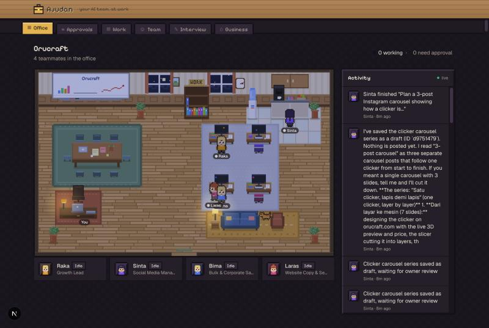

# Ajudan

AI teammates for your business. Ajudan interviews you about the business, designs a team of AI teammates, runs them on real work, and shows them in a 2D pixel-art office.



## Run it locally

Requirements: Node 22+, pnpm, and Claude Code installed and logged in (`claude`). Every LLM call goes through headless Claude Code (the Agent SDK) using your login.

```bash
pnpm install
pnpm dev        # creates the SQLite schema, starts Next.js on :3000 and the worker
```

Open http://localhost:3000, add your business and website, and do the interview.

**Or use the desktop app** (several businesses at once, one window each):

```bash
pnpm app                    # build, then open Ajudan (Electron)
pnpm app:package --install  # make Ajudan.app and put it in ~/Applications
```

- Every business window runs its own web server and worker pinned to its folder, so each open business keeps working at the same time. **File → Businesses…** (⌘N) or the header chip opens the list; **Open in a window** opens another business next to the first.
- The app reopens the windows you had open. Closing a window pauses that business (running work goes back to its queue).
- `Ajudan.app` is a small shell that runs this repo with your installed Node. After changing code, run `pnpm app` (or `pnpm build`) and reopen it. Logs are in `<folder>/logs/` (**File → Show Logs**).
- Because it's its own app, macOS asks for permissions (for example for Chrome or your folders) for "Ajudan" once and remembers them, instead of asking the terminal that ran `pnpm dev`.
- A folder has one worker at a time (`<folder>/.worker.lock`). Quit `pnpm dev` before opening its business in the app; until then the app's window waits.

**Talk to your manager.** Each hired team gets a manager (the **Manager** tab, where a business opens). Ask the manager anything:
- **Quick questions:** status, advice and "what needs my approval?" get answered directly.
- **Real work:** goes to the right teammates. Each delegation shows up under the manager's reply with live status.
- **Reporting back:** when all of it is finished, the manager posts a short team update in the same chat.

You can still chat with any teammate directly.

**One folder per business.** Each business lives in its own folder, by default `~/Ajudan/<Name>/`:

```
~/Ajudan/Orucraft/
  ajudan.db          team, tasks, approvals, history
  teammates/raka/    memory.md, BUSINESS.md, drafts
  work/              every deliverable as a .md file
  browser/           the business's logged-in Chrome profile
  backups/           database backups taken before schema changes
```

- **Switching:** the home page (or **Switch** in the header) lists your business folders. Only the open business works: its teammates run tasks and schedules, while the others are paused. When you switch, any running task goes back to its queue and runs again when you return.
- **Copying, moving, backing up:** do it to the folder. **Open a business folder** adds one that isn't listed.

## How it works

- **Web app** (Next.js 16, shadcn/ui with a pixel-game theme in `globals.css`): onboarding chat, team review, office, teammate chats, approvals, work.
- **Worker** (`worker/`): takes jobs from SQLite and runs each one with `runAgent()` (`src/lib/claude.ts`).
  - Each teammate runs in its own folder, `data/workspaces/<business>/<teammate>/`, with `BUSINESS.md` and its own `memory.md`.
- **Teammate tools** (`worker/tools.ts`): save work, delegate to a teammate, update their status, and publish/send.
  - Publish/send are **simulated**: no real integrations yet.
  - Autonomy setting: `draft` never publishes, `ask` needs your approval, `auto` acts alone.
- **Language**: each business has a primary language (e.g. Bahasa Indonesia), set at creation or on the Business page; every agent writes in it.
- **Business browser**: each business has its own Chrome profile in `data/browsers/<id>`. Open it from **Business → Business browser**, log in to Shopee Seller Center, TikTok, etc. once, then turn on "Can use the business browser" for a teammate on the Team page. Teammates drive it through Playwright MCP over CDP (`worker/browser.ts`, swappable provider):
  - They only open sites on the business's list.
  - They never type passwords or codes.
  - Before changing anything on a site they call `confirm_browser_action`, which follows their freedom setting (draft-only never changes anything).
  - One teammate drives the browser at a time.
- **WhatsApp** (via [wacli](https://wacli.sh), `brew install openclaw/tap/wacli`): link the business's WhatsApp on **Business → WhatsApp** by scanning a QR code. The session and message store live in `<folder>/whatsapp/`.
  - Tick the groups or communities teammates may use (e.g. the reseller community); every other chat stays invisible to them.
  - Turn on "Can use WhatsApp" for a teammate on the Team page. They can read and search those chats for context and post updates; posting follows their freedom setting (approvals for "ask first", never for "draft only").
  - Teammates can also message anyone else: a number, a contact (`find_contact`) or another group, and the same message to several people at once (`send_to_people`, approved as one list). Those always wait for your approval, even for teammates on full freedom, and only the people you approved can be messaged. Reading stays limited to the allowed chats.
  - Waiting for replies: when a teammate sends something it expects an answer to (by default to people, not groups), Ajudan keeps a watch (`wa_watches`, `worker/replies.ts`). The reply goes to that teammate as a task with the earlier message, photos, videos and voice notes transcribed. No reply by the deadline (default 24 h) brings one reminder to follow up or tell you. Replying in that conversation then follows the teammate's freedom setting. The manager page lists who the team is waiting on; emoji reactions don't count as replies.
  - Reply pace: a chat is live when they answer within 15 minutes, or when the teammate sent with `pace: "live"`. A live reply is handed over about 6 seconds after they stop typing, and they see "typing…" meanwhile. It runs in its own worker lane (`tasks.urgent`), so it never waits behind a video render, at low effort with the recent chat in the prompt. If the teammate needs to check something first, it sends a quick holding reply. Normal chats wait 25 s; `relaxed` collects messages for 2 minutes. One run per chat at a time: anything they add while a reply is still queued joins it. New messages arrive through the sync's local webhook; polling every 10 s is the fallback.
  - Teammates can also create a group (`create_group`), rename it, set its description or make it admins-only (`update_group`), and fetch its invite link. Changes go through approvals like posts. A group's picture can't be set via wacli, so set it on the phone.
  - While the folder is open, the worker keeps `wacli sync --follow` running and spaces sends 2–6s apart.
  - wacli uses the unofficial WhatsApp Web protocol, so keep volume human-sized.
- **Images**: teammates design social posts and carousel slides as HTML and render them to PNG (`render_image`, headless Chrome via `playwright-core`). Images are saved to `<folder>/work/images/` and attached to the work. See them on the Work page and under the teammate's reply; click a thumbnail to view it large or download it.
- **Media and video**: drop footage, photos, music or documents onto any chat (or use the paperclip). Files are streamed to `<folder>/media/` (`/api/b/[id]/media`) and attached to the message. The manager passes them on to whoever needs them (`assign_task(files=[…])`), and they're hard-linked into that teammate's folder.
  - Teammates look at footage with `inspect_media` (ffprobe) and `extract_frames` (ffmpeg stills they can Read), write the edit as one Remotion TSX file and call `render_video` (`worker/video.ts`: bundled with this repo's `node_modules`, rendered with your installed Chrome, one render at a time). MP4s go to `<folder>/work/videos/` and play inline in the chat and on the Work page.
  - Skills: `agent-plugins/ajudan-video/` is a local plugin loaded into every teammate run. It has `campaign-video` (Ajudan's file contract, platform specs, hooks, shot lists for asking you for footage) and a copy of Remotion's `remotion-best-practices`.
  - Free music, sound effects and photos: `find_free_assets` / `download_free_asset` (`src/lib/free-assets.ts`) search [Openverse](https://openverse.org) (Jamendo, Freesound, Flickr, Wikimedia; no key, about 200 searches a day). Only CC0, public domain and CC BY are allowed (no non-commercial, no-derivatives or share-alike). Downloads land in `<folder>/media/` with their credits in `media/.licenses.json`, and CC BY credits go into the caption.
  - When footage is missing, teammates send a shot list instead of faking it. There's a Video Editor role you can add on the Team page.
  - Needs `ffmpeg`/`ffprobe` on the PATH (`brew install ffmpeg`). Remotion is free for individuals and companies of up to 3 people; bigger companies need a [Remotion license](https://www.remotion.dev/license).
- **APIs and credentials**: put API keys on **Business → API keys & access** (or approve a teammate's request for one). The value goes to the macOS Keychain (`src/lib/secrets.ts`); teammates use `http_request` with `{{secret.NAME}}`, Ajudan fills it in only for that secret's hosts and hides it in responses. GET runs freely; POST/PUT/PATCH/DELETE follow the freedom setting.
- **Asking for abilities**: a teammate that's missing something (a credential, a shell, the browser or a site in it, WhatsApp) calls `request_capability`. It shows on the Approvals page; approving switches it on and gives the teammate a task to carry on (`src/lib/capabilities.ts`).
- **Sandboxed shell**: "Can run commands" on the Team page gives a teammate Bash (python, jq, node, curl) inside Claude Code's sandbox: it writes only in its own folder, reads that plus the business's `media/` and `work/`, and reaches only the domains under API keys & access. Secrets aren't in the shell.
- **Files tab**: browse the business folder's work, media library and each teammate's folder (memory, notes, drafts, renders). Markdown is rendered (with its images and videos), images and videos open in place, CSV shows as a table, JSON is formatted, and you can search by name or title. The database, browser profile, WhatsApp, backups, logs and dotfiles are never listed or served (`src/lib/browse.ts`).
- **Voice notes and speech**: people on WhatsApp can send voice notes. The worker transcribes them on this Mac with whisper.cpp (`brew install whisper-cpp`; model `~/.ajudan/models/ggml-large-v3-turbo-q5_0.bin`, 574 MB) and hands over the transcript (🎤) like a typed message. Teammates also have `transcribe_media` for footage and audio, with timed `.srt` captions for videos (`src/lib/speech.ts`). Audio never leaves the laptop.
- **Approve on WhatsApp**: on the Team page, mark yourself (a person on the team) as the owner. Every approval request is then also sent to your WhatsApp with a short code; answer "ya A7F2" / "tidak A7F2 <why>" (a bare "ya" works for the one just sent, "ya semua" approves all, a voice note works too). It goes through the same path as the Approvals page (`src/lib/approvals.ts`, `worker/owner-approvals.ts`), and the manager follows up with you on WhatsApp. Only that number can approve; API keys still have to be entered in the app.
- **Data**: SQLite at `<business folder>/ajudan.db` (Drizzle; schema in `src/db/schema.ts`). Live updates reach the browser over SSE from `activity_events`.

## Useful commands

```bash
pnpm typecheck && pnpm lint
pnpm worker:once                           # process queued jobs, then exit
pnpm db:generate && pnpm db:migrate        # after editing src/db/schema.ts (never drizzle-kit push)
AJUDAN_DATA_DIR=/tmp/demo pnpm dev         # pin one business folder (tests)
```

Before letting other businesses use it, set `ANTHROPIC_API_KEY`. Anthropic's terms don't allow serving other users on a Pro/Max subscription login.

## Known limitations

- Moving from the old shared `./data` folder: `npx tsx scripts/move-to-folder.ts <businessId>` copies a business into `~/Ajudan/<Name>/`. Orucraft has been moved already, and `./data` can be deleted once you are happy.
- `pnpm dev` runs the worker with `tsx watch`: editing files restarts it and any running task starts over from scratch.
- Teammate schedules (e.g. Mondays 08:00) run automatically while the worker is up, and they use your Claude quota.
- `publish_deliverable` / `send_message` only record the action; real outward channels are the business browser and WhatsApp.
- Videos: teammates can't listen to music, so they pick free tracks by title, mood and length.
- The "ask before changing a site" rule is enforced by the teammate's instructions plus approvals, not by blocking clicks. The site list and the blocked tools are hard limits.
